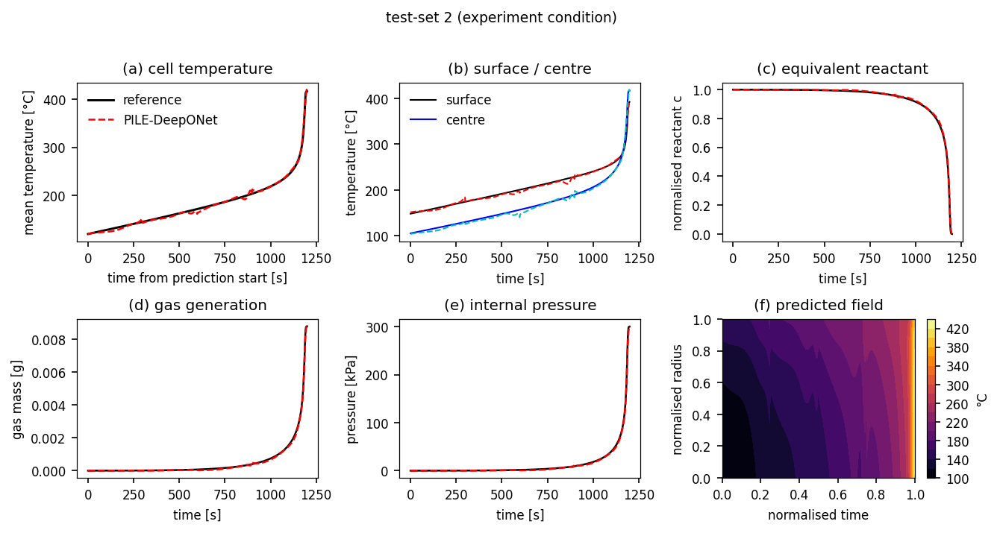

# PILE-DeepONet 复现：物理信息隐特征集成算子网络用于锂电池热失控实时预测

本仓库是对下述论文的**独立复现**（非官方代码，作者未公开源码）：

> Jeong, Kwak, Kim, Oh. **"Physics-informed latent ensemble DeepONet with synthetic data for
> real-time thermal runaway prognosis of a lithium-ion battery."**
> *eTransportation* 28 (2026) 100575. DOI: [10.1016/j.etran.2026.100575](https://doi.org/10.1016/j.etran.2026.100575)

复现内容包括论文的**全部四个组成部分**，但用自研求解器替代商业软件：

| 论文组成部分 | 论文做法 | 本仓库做法 |
| --- | --- | --- |
| 数据生成 | COMSOL 6.1 有限元，128 个热滥用工况 | `pile_deeponet/physics.py` 自研 1D 径向有限体积求解器（31 节点，与论文节点数一致），124 个工况 |
| 代理模型 | PILE-DeepONet（两级 DeepONet + 隐特征集成） | `pile_deeponet/model.py`，PyTorch 实现（论文用 JAX） |
| 训练策略 | 分离式 trunk、STAN 激活、NTK 自适应权重、无量纲化残差 | 全部实现（NTK 采用项级近似，见[复现说明](docs/01_复现说明.md)） |
| 评估 | WAPE / AREP / RMSE / MAE、消融、潜空间分析 | `pile_deeponet/evaluate.py` + `scripts/` |

---

## 1. 快速开始

```bash
# 1) 依赖（建议 CUDA 版 PyTorch）
pip install -r requirements.txt
#   pip install torch --index-url https://download.pytorch.org/whl/cu128

# 2) 生成合成数据集（1D FEM，124 工况，约 5 s）
python scripts/make_dataset.py --out data/lfp_4680.npz

# 3) 训练主模型（RTX 5090 约 40–60 min / 20k 迭代）
python scripts/train.py --out runs/pile

# 4) 评估 + 出图（WAPE/AREP 表、温度-压力曲线、误差条形图、显著性图）
python scripts/evaluate.py --ckpt runs/pile/best.pt --out results --tag pile

# 5) 消融实验（6 个变体）
python scripts/ablation.py --iters 4000
```

单条工况的交互式演示（用训练好的 checkpoint 预测一条新工况）：

```bash
python scripts/demo_case.py --ckpt runs/pile/best.pt --ramp 2600 --h-cool 7
```

---

## 2. 目录结构

```
pile-deeponet/
├── pile_deeponet/
│   ├── config.py      # 全部超参数（物理 / 数据划分 / 模型 / 训练）—— 改这里即可调参
│   ├── physics.py     # 1D 径向热失控求解器（COMSOL 的替代品）
│   ├── data.py        # 工况生成、分支输入 u1/u2/u3 构造、数据集读写
│   ├── batch.py       # 采样器（数据点 / 物理配点 / 边界 / 初值）
│   ├── model.py       # STAN 激活、编码器、DeepONet 算子、PILE-DeepONet
│   ├── losses.py      # 无量纲残差（Eq.16–18, 27–30）与各类损失项
│   ├── train.py       # 训练循环、NTK 自适应权重、验证与 checkpoint
│   ├── evaluate.py    # WAPE/AREP/RMSE/MAE 指标
│   ├── plots.py       # 论文风格图表
│   └── runner.py      # 组装：数据 → 训练 → 评估
├── scripts/
│   ├── make_dataset.py  train.py  evaluate.py  ablation.py  demo_case.py
├── docs/
│   ├── 01_复现说明.md      # 公式→代码映射、实现选择、与论文的差异
│   ├── 02_可调参数.md      # 所有可调旋钮及其物理/工程含义
│   ├── 03_应用方向.md      # 迁移到其他体系/场景的思路
│   └── 04_结果对比.md      # 与论文表格的逐项对比
├── data/    # 生成的 npz（.gitignore 忽略）
├── results/ # 指标 json 与图片
└── runs/    # 训练日志与 checkpoint（.gitignore 忽略）
```

---

## 3. 方法一句话概括

PILE-DeepONet 把"热失控预测"写成两个算子的复合：

```
(u1, u2, u3, x, d) --Ĝ_F--> 隐特征 X̂_F --Ĝ_P--> (T, c, Gas)
```

* **Ĝ_F（隐特征算子）**：由冷却能力 `u1`、历史表面温度趋势 `u2`（31 点/30 s）、
  近期温度趋势 `u3`（11 点/30 s）映射到隐空间；主干网络分别吃空间坐标 `x` 与
  预测提前量 `d`。
* **Ĝ_P（预测算子）**：在 Ĝ_F 的隐特征基础上再并联一路"隐特征标量" `u4`
  （4 个锚点提前量 900/990/1110/1200 s 处的隐特征），直接回归 `T, c, Gas`；
  压力由理想气体状态方程 `P = Gas·R_g·T/V` 导出。
* 两个算子都采用**多分支 × 多主干**的乘积集成（论文 Eq.9–11），
  并用**编码器跳跃连接**（Appendix A）在深层注入输入/输出的线性编码。
* 训练损失 = 数据项 + 物理残差项（Eq.16–18）+ 边界/初值项，全部无量纲化，
  并用 NTK 自适应权重平衡。

---

## 4. 结果摘要

> 详细数字见 [docs/04_结果对比.md](docs/04_结果对比.md)，与论文的差异见 [docs/01_复现说明.md](docs/01_复现说明.md)。

主模型为 `runs/pile_late`（`train.d_power = 3`，物理残差项关闭，2500 迭代，RTX 5090 约 6 min）：

| 指标 | 论文 | 本复现（test1 / test2 / test3） |
| --- | --- | --- |
| WAPE 总量（T+P+c+Gas 之和，%） | 3.12 | 13.33 / 13.76 / 32.68 |
| 温度峰值 AREP（%） | 1.15 / 1.68 / 8.75 | **0.87 / 0.91 / 1.53** |
| 峰值时刻 AREP（%） | 0.26 / 0.31 / 0.46 | 0.07 / 0.08 / 0.06 |
| RMSE 表面温度（K） | 3.14 | 3.58 / 3.47 / 4.01 |
| 峰值温度（test2，°C） | 403.38（实验 394.18） | 420.27（求解器 416.49） |



**三点结论**（详见 [docs/04_结果对比.md](docs/04_结果对比.md)）：

1. 架构与训练策略完整复现，消融排序在物理项开启的组别内与论文一致
   （无 NTK 最差 → 无 STAN → 无隐特征算子），说明各组件的相对作用被正确捕捉。
2. **峰值温度/峰值时刻的预测精度已达到甚至优于论文**（AREP_T 0.9% vs 1.15–1.68%），
   这正是热失控预警最关心的量。
3. **物理约束项在本复现中反而使精度变差**（18.9 → 27–40），原因已定位到求解器用集总
   动力学、而残差逐节点计算速率这一不一致，详见 docs/04 §5 与 docs/01 的差异表。
   这是本复现与论文最大的分歧，也是仓库里最值得继续做的一处改进。

> 注：本复现的“真值”来自自研 1D FEM（非 COMSOL），训练迭代数 2.5k（论文 300k，
> A100 上 11 h）。因此**绝对数值不应与论文逐位对比**，应关注趋势、排序与上述结论。

---

## 5. 引用

```bibtex
@article{jeong2026pile,
  title   = {Physics-informed latent ensemble DeepONet with synthetic data for real-time
             thermal runaway prognosis of a lithium-ion battery},
  journal = {eTransportation},
  volume  = {28},
  pages   = {100575},
  year    = {2026},
  doi     = {10.1016/j.etran.2026.100575}
}
```

## 6. 许可

MIT（见 [LICENSE](LICENSE)）。论文版权归原作者/Elsevier 所有，本仓库仅包含独立实现的代码。
